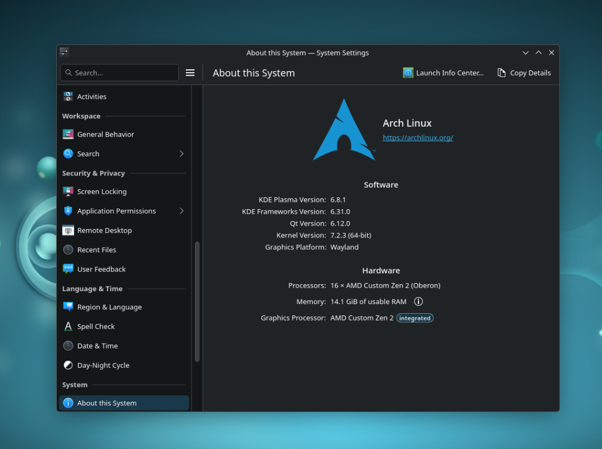

# CachyOS on PS5

**Run a full Linux desktop and Steam on a jailbroken PS5, and fix the problems you hit along the way:** black screens, Wi-Fi, Bluetooth, Gaming Mode crashes and the DualSense.




<sub>KDE Plasma 6.8.1 on Wayland, kernel 7.2.3, running on the PS5's AMD Oberon APU. KDE says "Arch Linux" because the CachyOS image is Arch with the CachyOS package repo on top.</sub>

### Tested on

| | |
|---|---|
| **PS5 firmware** | 13.60 |
| **Linux loader** | [soniciso1's ps5-linux-loader](https://github.com/soniciso1/ps5-linux-loader/releases) |
| **Drive** | 1 TB USB-C SSD, USB-C to USB-C cable |
| **OS image** | official [ps5-linux CachyOS image](https://github.com/ps5-linux/ps5-linux-image/releases/tag/latest) |
| **Kernel** | 7.2.3, built with [ps5-linux-patches](https://github.com/ps5-linux/ps5-linux-patches) |
| **Desktop** | KDE Plasma (Gaming Mode optional) |

Big thanks to **[soniciso1](https://github.com/soniciso1)** for the loader with 13.60 support, and to the **[ps5-linux](https://github.com/ps5-linux)** project for the kernel, image and tools. Full list in [Credits](#credits).

> [!IMPORTANT]
> **Rebooting Linux takes you back to PS5 OS.** To get into Linux again, run the exploit and the loader again. Test new kernels with **kexec** so you stay in Linux, and only make one the default once it works.

> [!TIP]
> **You can do every fix in this guide from tty2.** Plug in a USB keyboard, press <kbd>Ctrl</kbd>+<kbd>Alt</kbd>+<kbd>F2</kbd> and log in as **`steam`** / **`steam`**. Press <kbd>Ctrl</kbd>+<kbd>Alt</kbd>+<kbd>F1</kbd> to go back. If tty2 is black too, type blind; the commands still run.
>
> Switching TTYs can disconnect the USB keyboard and mouse. If they stop responding, **unplug them and plug them back in**.

---

## Contents

**Part 1: Install**

1. [Flash CachyOS to the SSD](#1-flash-cachyos-to-the-ssd)
2. [Boot into Linux](#2-boot-into-linux)
3. [First boot](#3-first-boot)

**Part 2: Make it usable**

4. [Boot straight to the desktop](#4-boot-straight-to-the-desktop)
5. [Black screen fixes](#5-black-screen-fixes)
6. [Wi-Fi](#6-wi-fi)
7. [Install all the fixes in one go](#7-install-all-the-fixes-in-one-go)

**Part 3: Hardware fixes**

8. [Bluetooth and the DualSense](#8-bluetooth-and-the-dualsense)
9. [Fan, performance and memory](#9-fan-performance-and-memory)
10. [Video playback and refresh rates](#10-video-playback-and-refresh-rates)

**Part 4: Advanced**

11. [Boot settings and building your own kernel](#11-boot-settings-and-building-your-own-kernel)
12. [Modules and sysctl silently not loading](#12-modules-and-sysctl-silently-not-loading)

[What's in this repo](#whats-in-this-repo) · [Credits](#credits)

---

# Part 1: Install

## 1. Flash CachyOS to the SSD

Linux runs entirely from an external SSD. Nothing is installed on the PS5's internal storage.

**You need:**
- A jailbroken PS5 and a Linux loader. I use [soniciso1's ps5-linux-loader](https://github.com/soniciso1/ps5-linux-loader/releases) on 13.60. Pick the release that matches your firmware.
- An external USB 3 SSD and a cable for it
- A PC to flash the image

> [!CAUTION]
> Flashing **erases the whole SSD**.

**Download** `ps5-cachyos.img.xz` from the [latest ps5-linux-image release](https://github.com/ps5-linux/ps5-linux-image/releases/tag/latest), and check it against the SHA256 listed there:
```sh
wget https://pub-561df4012f1a46fbbdf618d5cc5941f6.r2.dev/ps5-cachyos.img.xz
sha256sum ps5-cachyos.img.xz     # must match the checksum on the release page
```

**Flash it:**
- **Windows / macOS:** [balenaEtcher](https://etcher.balena.io/) can flash the `.img.xz` directly.
- **Linux:** find the SSD with `lsblk` (a 1 TB drive shows as ~931G) and write to the **whole disk** (`/dev/sdX`, not `/dev/sdX1`):
  ```sh
  xzcat ps5-cachyos.img.xz | sudo dd of=/dev/sdX bs=4M status=progress conv=fsync
  ```

The SSD now has two partitions:

| Partition | Label | Contents |
|---|---|---|
| p1 (ext4) | `cachyos` | The system. Starts at ~12 GB and grows to fill the SSD on first boot. |
| p2 (FAT32) | `boot` | `bzImage`, `initrd.img`, `cmdline.txt`, `kexec.sh` |

> [!TIP]
> **Optional, while the SSD is still on the PC:**
> - Make it boot straight to the desktop: create `home/steam/.config/ps5-next-session` on p1 containing just `plasma` (owned by uid 1000). See [section 4](#4-boot-straight-to-the-desktop).
> - Add the USB SSD boot settings to `cmdline.txt` on p2. See [section 11](#11-boot-settings-and-building-your-own-kernel).

<sub>[↑ Back to contents](#contents)</sub>

## 2. Boot into Linux

**Plug in the SSD:**
- ✅ the **front USB-C port**, or
- ✅ one of the **rear USB 3.0 ports**
- ❌ **not the front USB-A port**: it's only USB 2.0

> [!WARNING]
> **Don't run any other payloads before the Linux loader.** If anything else is already loaded (homebrew, FTP, cheats, etc.), the loader **crashes**. Start from a fresh boot every time.

1. **Turn on** (or restart) the PS5, so nothing else is loaded.
2. **Run your exploit** (Y2JB, Relapse, etc.).
3. **Load only the ps5-linux-loader payload**, either:
   - **from your PC** over the local network, using your payload sender, **or**
   - **from a payload manager** on the PS5.
4. The PS5 **goes into rest mode** by itself. It does *not* jump straight into Linux.
5. **Wait for the power light:** it pulses (breathes) orange for a while. Wait until it **stops pulsing and stays solid orange**.
6. **Press the power button** on the console. It now boots into Linux.

If it crashes or freezes, restart the PS5 and start again from step 1. Usually another payload was still running.

<sub>[↑ Back to contents](#contents)</sub>

## 3. First boot

> [!NOTE]
> **A black screen on first boot is common.** Linux is usually running fine and only the HDMI picture didn't come up. Press <kbd>Ctrl</kbd>+<kbd>Alt</kbd>+<kbd>F2</kbd>, wait 2–3 seconds, then <kbd>Ctrl</kbd>+<kbd>Alt</kbd>+<kbd>F1</kbd>. Repeat once or twice if needed. Still black? See [Black screen fixes](#5-black-screen-fixes).

What happens on first boot:
- The system partition **grows to fill the whole SSD** automatically (runs once).
- A **setup screen** on tty1 asks for timezone, hostname and password.

| Default | |
|---|---|
| User | `steam` |
| Password | `steam` |
| Hostname | `ps5` |

> [!WARNING]
> **Change the password** (pick *Customize* in the setup screen, or run `passwd` later). SSH with password login is on by default.

Check it worked: `lsblk` should show p1 at roughly the full size of your SSD.

<sub>[↑ Back to contents](#contents)</sub>

---

# Part 2: Make it usable

## 4. Boot straight to the desktop

**Problem:** the image starts **Gaming Mode** (gamescope) on boot. Steam's **Power → Switch to Desktop** crashes or leaves a black screen every time, because going from gamescope to the desktop breaks the PS5's HDMI bridge until a real reboot.

**Fix:** a one-word file, `~/.config/ps5-next-session`, decides what starts. Set it to `plasma`:

```sh
echo plasma > ~/.config/ps5-next-session
sudo reboot    # then run the exploit + loader again
```
Or use the script from this repo: `./scripts/boot-to-desktop.sh` (`./scripts/boot-to-desktop.sh gamescope` to switch back).

From Gaming Mode on first boot, do this on tty2 (<kbd>Ctrl</kbd>+<kbd>Alt</kbd>+<kbd>F2</kbd>, log in `steam` / `steam`).

**Good to know:**
- It stays on the desktop across reboots, as long as you **reboot or shut down** from the desktop.
- **Logging out** of Plasma drops you into Gaming Mode and resets the file to `gamescope`. Run the `echo plasma` line again.
- **Want Gaming Mode?** `echo gamescope > ~/.config/ps5-next-session` and reboot. Desktop → Gaming Mode is fine; only Gaming Mode → desktop is broken.
- You can still run Steam Big Picture from the desktop.

<sub>[↑ Back to contents](#contents)</sub>

## 5. Black screen fixes

**Why it happens:** the GPU outputs DisplayPort to an internal DP→HDMI bridge. Below 4K the driver lowers the link speed, the bridge fails to sync (dmesg: `could not get CR after 100 tries`), and the screen goes black.

### Quick fixes (no reboot)

Try these in order. **1 to 3 need no picture, no network and nothing installed.**

**1. Switch TTYs (easiest).** Press <kbd>Ctrl</kbd>+<kbd>Alt</kbd>+<kbd>F2</kbd>, wait 2–3 seconds, then <kbd>Ctrl</kbd>+<kbd>Alt</kbd>+<kbd>F1</kbd>. This forces the display to resync. Repeat once or twice if needed. You need a USB keyboard, because the DualSense can't send these keys. If the keyboard or mouse stops working afterwards, unplug it and plug it back in.

**2. Switch the TV/monitor input** away and back. Sometimes the TV just loses sync.

**3. Fix it from tty2.** Press <kbd>Ctrl</kbd>+<kbd>Alt</kbd>+<kbd>F2</kbd>, log in `steam` / `steam` (type blind if it's black), run the commands from fix 5, then press <kbd>Ctrl</kbd>+<kbd>Alt</kbd>+<kbd>F1</kbd>.

**4. Fix it over SSH** from a phone or PC:
- Use an **Ethernet cable**. Ethernet works out of the box; **Wi-Fi doesn't** until you install the driver in [section 6](#6-wi-fi).
- Find the PS5's IP in your router's list of connected devices (hostname `ps5`).
- `ssh steam@<ip>`, password `steam`. Then switch TTYs remotely:
  ```sh
  sudo chvt 2; sleep 3; sudo chvt 1
  ```
- If this repo is on the PS5, `sudo ./scripts/fix-black-screen.sh` does the TTY switch and fix 5 in one go.

**5. Re-lock the link and force a hotplug** (from tty2 or SSH):
```sh
echo "4 0x1e" | sudo tee /sys/kernel/debug/dri/0/DP-1/link_settings
echo 1 | sudo tee /sys/kernel/debug/dri/0/DP-1/trigger_hotplug
```
Still black? Wait for `hdmi: got real edid` in dmesg and run the hotplug line **a second time**. On the KDE desktop the hotplug can make KWin lose the screen, so try the TTY switch first there. In Gaming Mode it's fine.

### Permanent fix

1. **Safe mode at boot:** `video=DP-1:1920x1080@60` in `cmdline.txt` (already in the image's default).
2. **Lock the link at 4 lanes HBR3** before the display starts. `sudo ./install.sh` from this repo sets this up ([section 7](#7-install-all-the-fixes-in-one-go)).

<details>
<summary>What install.sh adds for this (dp-link-lock)</summary>

`/usr/local/bin/dp-link-lock`:
```sh
#!/bin/sh
f=/sys/kernel/debug/dri/0/DP-1/link_settings
mountpoint -q /sys/kernel/debug || mount -t debugfs none /sys/kernel/debug
for i in $(seq 60); do [ -e "$f" ] && break; sleep 0.5; done
echo "4 0x1e" > "$f"
```
`/etc/systemd/system/dp-link-lock.service`:
```ini
[Unit]
Description=Lock DP-1 link to 4x HBR3 (PS5 HDMI bridge)
After=systemd-modules-load.service sys-kernel-debug.mount
Before=display-manager.service

[Service]
Type=oneshot
RemainAfterExit=yes
ExecStart=/usr/local/bin/dp-link-lock

[Install]
WantedBy=multi-user.target
```
To install it by hand:
```sh
sudo chmod +x /usr/local/bin/dp-link-lock
sudo systemctl enable dp-link-lock
```
</details>

- A few `CR` errors and a warning trace in dmesg at boot are **normal**, even when it's working.
- Check it: `cat /sys/kernel/debug/dri/0/DP-1/link_settings` should show `Preferred: 4 0x1e`.

<sub>[↑ Back to contents](#contents)</sub>

## 6. Wi-Fi

The kernel has no built-in driver for the PS5's Wi-Fi chip. Install the PS5-patched driver from [ps5-linux-mwifiex](https://github.com/ps5-linux/ps5-linux-mwifiex).

**Getting online to download it:** use an **Ethernet cable** (works out of the box), or download `ps5-linux-mwifiex` on a PC and copy it onto the SSD (e.g. into `/home/steam/`) before booting.

```sh
git clone https://github.com/ps5-linux/ps5-linux-mwifiex
cd ps5-linux-mwifiex
sudo ./install.sh        # builds for your running kernel and loads it right away
nmcli radio wifi on
```

> [!IMPORTANT]
> **Run `install.sh` again after every kernel update**, or Wi-Fi disappears.

### Connect to your network

**From tty2** (<kbd>Ctrl</kbd>+<kbd>Alt</kbd>+<kbd>F2</kbd>, log in `steam` / `steam`):
```sh
nmcli radio wifi on
nmcli device wifi list                                    # find your network
nmcli device wifi connect "YourNetwork" password "YourPassword"
```
Or run `nmtui` for a simple menu: **Activate a connection** → pick your network → type the password.

**From the desktop:** click the network icon in the panel (bottom right).

**From Gaming Mode:** try **Steam → Settings → Internet**. If your network isn't listed, use tty2.

It reconnects on its own at every boot. Check with `nmcli device status`: `wlp64s0f7` should say `connected`.

<details>
<summary>Troubleshooting</summary>

- When the driver works, dmesg shows `WLAN FW is active` and then `Driver loaded successfully`.
- Shows `unavailable`? The radio is soft-blocked: `nmcli radio wifi on` or `rfkill unblock wifi`.
- If the linux-ps5 package's `moal.conf` is also in `/etc/modprobe.d/`, both files have `options moal` lines and **modprobe merges them**. Keep them in sync or remove one.
</details>

<sub>[↑ Back to contents](#contents)</sub>

## 7. Install all the fixes in one go

```sh
git clone https://github.com/abrocoma/cachyos-ps5-guide
cd cachyos-ps5-guide
sudo ./install.sh                 # black screen lock, DualSense reconnect, zram, boot-order fix
./scripts/boot-to-desktop.sh      # boot straight to the desktop instead of Gaming Mode
```
Then reboot (and run the exploit + loader again, see [section 2](#2-boot-into-linux)).

`install.sh` doesn't touch the kernel, the Wi-Fi driver or `/boot/efi`. Those are covered in sections 6 and 11.

<sub>[↑ Back to contents](#contents)</sub>

---

# Part 3: Hardware fixes

## 8. Bluetooth and the DualSense

The PS5's Wi-Fi/Bluetooth chip (NXP IW620) sits on two buses: **Wi-Fi on PCIe**, **Bluetooth on USB**. So one can work while the other is dead.

### DualSense pairs once, then won't reconnect

**Cause:** the Bluetooth adapter starts up as **non-connectable**. **Fix:** `sudo ./install.sh` ([section 7](#7-install-all-the-fixes-in-one-go)), then:
```sh
sudo systemctl enable --now bluetooth bt-connectable
```

<details>
<summary>What install.sh adds for this</summary>

`/etc/systemd/system/bt-connectable.service`:
```ini
[Unit]
Description=Make Bluetooth adapter accept incoming connections (DualSense reconnect)
After=bluetooth.service
Requires=bluetooth.service

[Service]
Type=oneshot
ExecStartPre=/usr/bin/sleep 2
ExecStart=/usr/bin/btmgmt connectable on
RemainAfterExit=yes

[Install]
WantedBy=bluetooth.target
```
`/etc/modules-load.d/dualsense.conf`:
```
hidp
hid_playstation
```
</details>

**Controller quirks:**
- **Using the controller in PS5 OS breaks the Linux pairing.** Remove it in Linux and pair again.
- **Don't plug in USB while it's connected over Bluetooth** (`Duplicate device found for MAC`). Disconnect Bluetooth first.
- **The speaker and headphone jack only work over USB**, not Bluetooth.

### No Bluetooth adapter at all

**Symptom:** no `hci0`, and dmesg shows `xhci_hcd 0000:40:00.6: Host halt failed, -110`.

**Cause:** a 2026-09 [ps5-linux-patches](https://github.com/ps5-linux/ps5-linux-patches) commit ("disable xhci") turns off the init of the USB controller that Bluetooth is on (`xhci_salina_init()` is wrapped in `#if 0`). Kernels built before that commit are fine.

**Fix:** needs a kernel rebuild ([section 11](#11-boot-settings-and-building-your-own-kernel)). Apply `patches/0001-xhci-pci-re-enable-salina-init.patch` from this repo in the kernel tree (`patch -p1 < .../0001-*.patch`), or delete that `#if 0` / `#endif` by hand, then rebuild and boot the bzImage. Reloading modules or rebinding won't help, because xHCI is built into the kernel.

When it works, dmesg shows the controller deferring (`-517`) and then initializing, and `hci0` appears. A `-110` error on the SATA controller (40:00.3) is unrelated and harmless.

<sub>[↑ Back to contents](#contents)</sub>

## 9. Fan, performance and memory

**Fan and boost:** without these the fan stays off and boost is disabled. Install [ps5-linux-tools](https://github.com/ps5-linux/ps5-linux-tools):
```sh
git clone https://github.com/ps5-linux/ps5-linux-tools
cd ps5-linux-tools
sudo ./install.sh
sudo systemctl enable --now ps5fan ps5boost
```

**Memory:** zram swap (`zram-size = ram / 2`, `compression-algorithm = zstd`). `install.sh` from this repo sets it up.

<sub>[↑ Back to contents](#contents)</sub>

## 10. Video playback and refresh rates

**Chrome hardware video decode:** put these in `~/.config/chrome-flags.conf`:
```
--ozone-platform=wayland
--enable-features=AcceleratedVideoDecodeLinuxGL,AcceleratedVideoDecodeLinuxZeroCopyGL,AcceleratedVideoEncoder,VaapiIgnoreDriverChecks
```
- **Firefox** uses hardware decode out of the box.
- The APU has **no AV1 decode**. Use the enhanced-h264ify extension for YouTube.
- There's no GPU load sensor, so KDE's system monitor shows nothing. Use `nvtop`.

**Refresh rates:**

| Mode | Status |
|---|---|
| 1080p @ 120 Hz | ✅ stable, recommended |
| 1080p @ 60 Hz | ✅ |
| 1440p @ 60 Hz | ✅ |
| 2160p @ 60 Hz | ✅ |
| 1440p @ 120 Hz | ⚠️ needs an experimental `hdmi.c` patch, not fully stable yet |

<sub>[↑ Back to contents](#contents)</sub>

---

# Part 4: Advanced

## 11. Boot settings and building your own kernel

### Boot settings for USB SSDs

**Problem:** root not found, or boot hangs waiting for the disk. The USB SSD shows up slowly, and USB-C SSDs can drop off under load. My `cmdline.txt` (on the `boot` partition):
```
root=LABEL=cachyos-ssd rw rootwait rootdelay=60 usbcore.autosuspend=-1 usb-storage.quirks=xxxx:yyyy:u console=ttyTitania0 console=tty0 video=DP-1:1920x1080@60 mitigations=off idle=halt preempt=full
```

| Setting | What it does |
|---|---|
| `rootwait rootdelay=60` | Waits for the disk to show up |
| `usbcore.autosuspend=-1` | Stops USB from going to sleep |
| `usb-storage.quirks=xxxx:yyyy:u` | Turns off UAS for the SSD. Many USB-C SSDs have buggy UAS (resets, I/O errors, freezes). **Replace `xxxx:yyyy`** with your drive's ID from `lsusb`. Several drives: `xxxx:yyyy:u,aaaa:bbbb:u` |
| `video=DP-1:1920x1080@60` | Safe display mode at boot ([section 5](#5-black-screen-fixes)) |

**Renaming the root label (optional):** mine is `cachyos-ssd` instead of `cachyos`, which helps with more than one ps5-linux drive. If you rename it (`sudo e2label /dev/sdX1 cachyos-ssd`), change `root=LABEL=` in `cmdline.txt` **and** the `/` line in `/etc/fstab`, or it won't boot.

### Building your own kernel

Only needed for the [Bluetooth fix](#no-bluetooth-adapter-at-all) or the 1440p120 patch. The image's kernel works without it.

Use the mainline kernel source with `linux.patch` and `.config` from [ps5-linux-patches](https://github.com/ps5-linux/ps5-linux-patches). Then:

| Problem | Fix |
|---|---|
| Kernel changes do nothing / wrong kernel boots | The PS5 boots from `/boot/efi/{bzImage,initrd.img,cmdline.txt}`, **not** `/boot`. `make install` does nothing; copy the kernel and initrd into `/boot/efi` yourself. |
| Huge initramfs, slow or failing boot | `make modules_install INSTALL_MOD_STRIP=1`. Unstripped, amdgpu.ko alone is ~775 MB and the initramfs grows to ~300 MB. |
| No hardware video decode | Copy `firmware/amdgpu/ps5_vcn.bin` from ps5-linux-patches to `/lib/firmware/amdgpu/` **before** running mkinitcpio. |

<sub>[↑ Back to contents](#contents)</sub>

## 12. Modules and sysctl silently not loading

**Symptom:** things randomly don't work after boot.

**Cause:** `ps5-stage-firmware.service` creates an ordering cycle, so systemd quietly skips `systemd-sysctl` and `systemd-modules-load`.

**Fix:** `install.sh` does this for you. By hand, add this to the `[Unit]` section of that service:
```ini
DefaultDependencies=no
```
Check: `journalctl -b | grep -i "ordering cycle"` should return nothing.

<sub>[↑ Back to contents](#contents)</sub>

---

## What's in this repo

| Path | What it is | Section |
|---|---|---|
| `install.sh` | Installs and enables the fixes | 7 |
| `scripts/boot-to-desktop.sh` | Pick `plasma` or `gamescope` for the next boot | 4 |
| `scripts/fix-black-screen.sh` | TTY switch + link re-lock + double hotplug | 5 |
| `files/usr/local/bin/dp-link-lock` | Locks the display link to 4 lanes HBR3 | 5 |
| `files/etc/systemd/system/dp-link-lock.service` | Runs it before the display starts | 5 |
| `files/etc/systemd/system/bt-connectable.service` | Lets the DualSense reconnect | 8 |
| `files/etc/modules-load.d/dualsense.conf` | Loads `hidp` + `hid_playstation` | 8 |
| `patches/0001-xhci-pci-re-enable-salina-init.patch` | Kernel patch that brings Bluetooth back | 8 |
| `files/etc/systemd/zram-generator.conf` | zram swap, ram/2, zstd | 9 |
| `files/home/steam/.config/chrome-flags.conf` | Chrome hardware decode flags | 10 |
| `files/boot/efi/cmdline.txt.example` | Kernel command line | 11 |
| `files/home/steam/.config/ps5-next-session` | Session file (`plasma`) | 4 |

## Credits

- **[soniciso1/ps5-linux-loader](https://github.com/soniciso1/ps5-linux-loader/releases)**: Linux loader with 13.60 support
- **[ps5-linux](https://github.com/ps5-linux)**:
  - [ps5-linux-image](https://github.com/ps5-linux/ps5-linux-image): prebuilt CachyOS image
  - [ps5-linux-patches](https://github.com/ps5-linux/ps5-linux-patches): kernel patches, `.config`, `ps5_vcn.bin`
  - [ps5-linux-mwifiex](https://github.com/ps5-linux/ps5-linux-mwifiex): Wi-Fi driver
  - [ps5-linux-tools](https://github.com/ps5-linux/ps5-linux-tools): fan and boost control

This repo only collects the fixes I needed on top.
