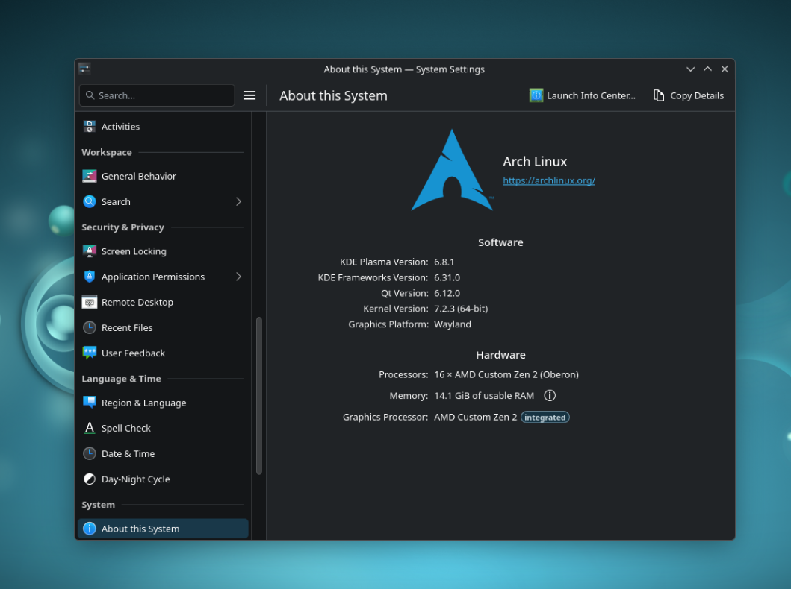
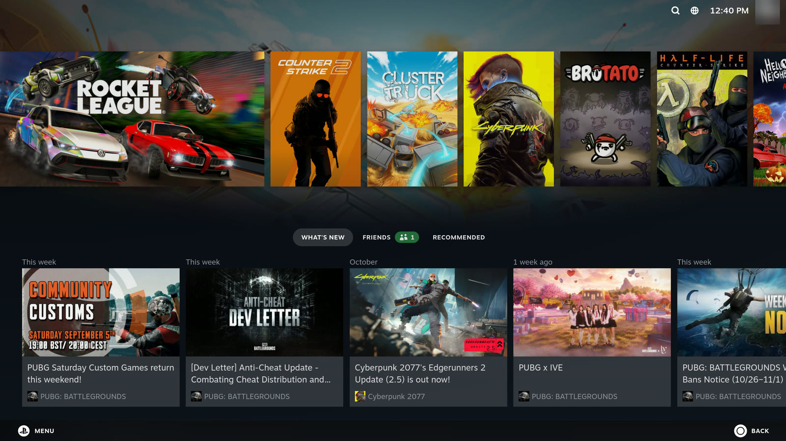
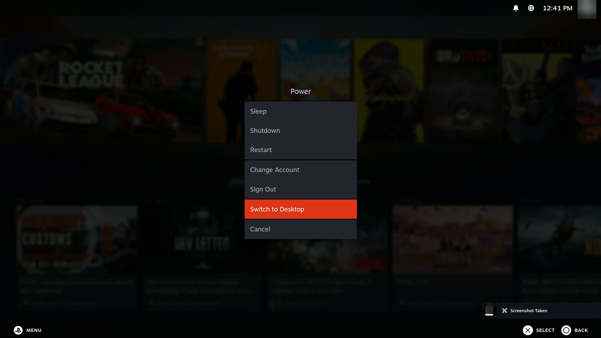
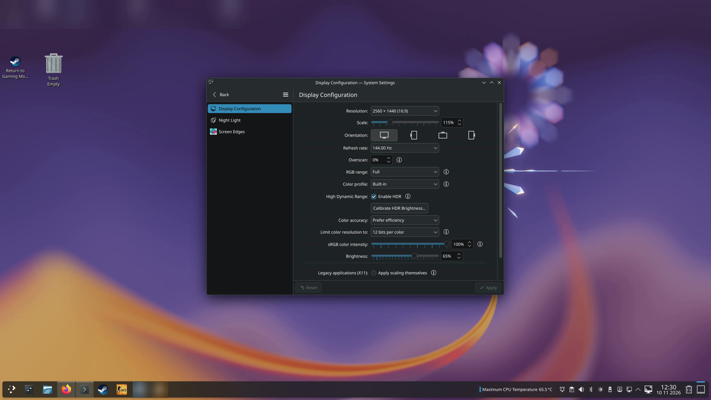
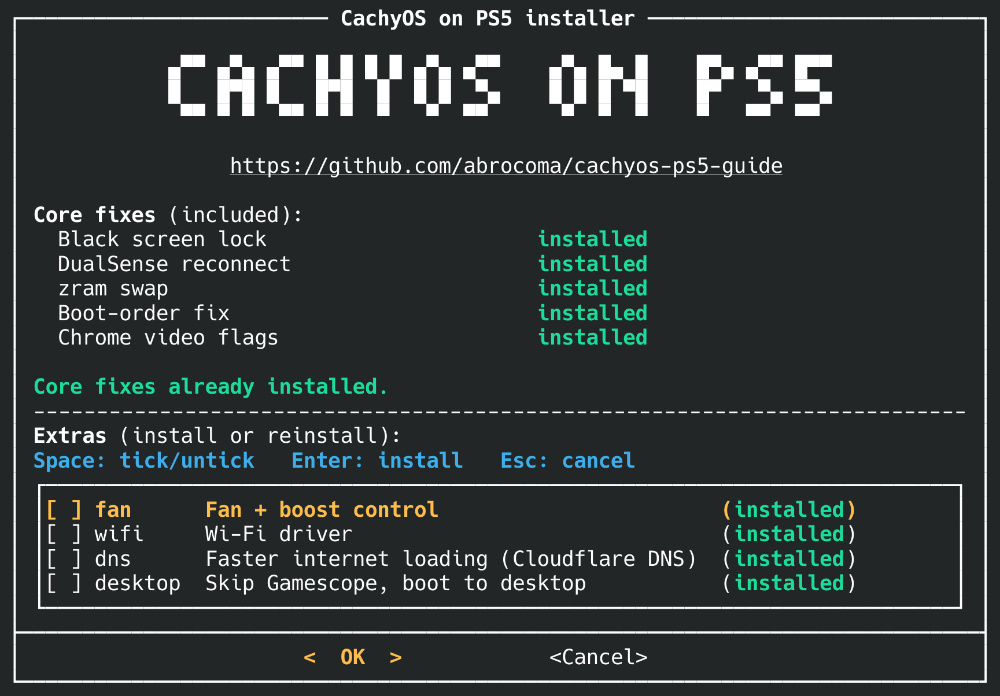
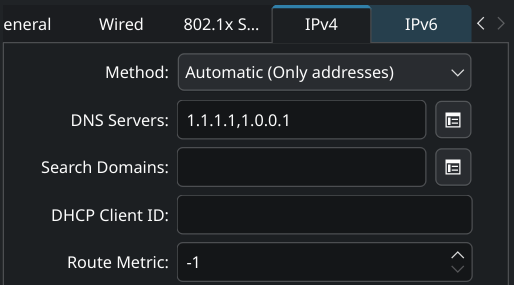

# CachyOS on PS5

**Run a full Linux desktop and Steam on a jailbroken PS5.** Flash a ready-made image, boot it, play. The rest of this guide covers using it, fixing what can still go wrong, and doing it all by hand on the official image.




<sub>KDE Plasma on Wayland, kernel 7.2.3, running on the PS5's AMD Oberon APU. KDE says "Arch Linux" because the CachyOS image is Arch with the CachyOS package repo on top.</sub>

### Tested on

| | |
|---|---|
| **Console** | PS5 launch model ("phat") Digital Edition, CFI-1016B |
| **PS5 firmware** | 13.60 |
| **Linux loader** | [soniciso1's ps5-linux-loader](https://github.com/soniciso1/ps5-linux-loader/releases) |
| **Drive** | 1 TB USB-C SSD, USB-C to USB-C cable |
| **OS image** | [this guide's image](https://github.com/abrocoma/cachyos-ps5-guide/releases/latest), based on the official [ps5-linux CachyOS image](https://github.com/ps5-linux/ps5-linux-image/releases/tag/latest) |
| **Kernel** | 7.2.3 + [ps5-linux-patches](https://github.com/ps5-linux/ps5-linux-patches) `5f6b5d3` |
| **Screens** | 1440p 144 Hz monitor, 4K 60 Hz TV |

Big thanks to **[soniciso1](https://github.com/soniciso1)** for the loader with 13.60 support, and to the **[ps5-linux](https://github.com/ps5-linux)** project for the kernel, image and tools. Full list in [Credits](#credits).

> [!IMPORTANT]
> **Rebooting Linux takes you back to PS5 OS.** To get into Linux again, run the exploit and the loader again.

> [!TIP]
> **You can do everything in this guide from tty2.** Plug in a USB keyboard, press <kbd>Ctrl</kbd>+<kbd>Alt</kbd>+<kbd>F2</kbd> and log in as **`steam`** / **`steam`**. Press <kbd>Ctrl</kbd>+<kbd>Alt</kbd>+<kbd>F1</kbd> to go back. If the keyboard or mouse stops responding after switching, **unplug it and plug it back in**.

---

## Contents

**Part 1: Quick start**

1. [Flash the image](#1-flash-the-image)
2. [Boot into Linux](#2-boot-into-linux)
3. [First boot and getting online](#3-first-boot-and-getting-online)

**Part 2: Using it**

4. [Gaming Mode and the desktop](#4-gaming-mode-and-the-desktop)
5. [Display: resolutions, refresh rates and HDR](#5-display-resolutions-refresh-rates-and-hdr)
6. [Extras: boost, fan, video and DNS](#6-extras-boost-fan-video-and-dns)

**Part 3: Troubleshooting**

7. [Black screen](#7-black-screen)
8. [Drive not found at boot](#8-drive-not-found-at-boot)
9. [Wi-Fi and Bluetooth](#9-wi-fi-and-bluetooth)
10. [Websites slow to start loading](#10-websites-slow-to-start-loading)

**Part 4: Using the official image instead**

11. [All fixes for the official image](#11-all-fixes-for-the-official-image)

**Part 5: Advanced**

12. [Building your own kernel](#12-building-your-own-kernel)

[What's in this repo](#whats-in-this-repo) · [Credits](#credits)

---

# Part 1: Quick start

## 1. Flash the image

Linux runs entirely from an external SSD. Nothing is installed on the PS5's internal storage.

**You need:**
- A jailbroken PS5 and a Linux loader. I use [soniciso1's ps5-linux-loader](https://github.com/soniciso1/ps5-linux-loader/releases) on 13.60. Pick the release that matches your firmware.
- An external USB 3 SSD and a cable for it
- A PC to flash the image

> [!CAUTION]
> Flashing **erases the whole SSD**.

**Download** `ps5-cachyos-7.2.3-p5f6b.img.xz` (2 GB) from [this guide's latest release](https://github.com/abrocoma/cachyos-ps5-guide/releases/latest). It's the official ps5-linux image with every fix from this guide already installed:

| | |
|---|---|
| **Display** | No black screens at 1080p/1440p, up to 1440p 144 Hz and 4K 60 Hz, desktop HDR, 12-bit colour |
| **Gaming Mode** | SteamOS-style Steam, display and network settings in Steam, working **Switch to Desktop** |
| **Hardware** | Kernel 7.2.3 + ps5-linux-patches `5f6b5d3`, Wi-Fi driver, DualSense reconnect, automatic fan curve |
| **System** | zram swap, boot-order fix, USB SSD boot settings, Chrome video decode flags |

```sh
wget https://github.com/abrocoma/cachyos-ps5-guide/releases/download/image-2026-11-10/ps5-cachyos-7.2.3-p5f6b.img.xz
wget https://github.com/abrocoma/cachyos-ps5-guide/releases/download/image-2026-11-10/ps5-cachyos-7.2.3-p5f6b.img.xz.sha256
sha256sum -c ps5-cachyos-7.2.3-p5f6b.img.xz.sha256     # must say OK
```

**Flash it:**
- **Windows / macOS:** extract the `.img.xz` first to get the `.img` (Windows: [7-Zip](https://www.7-zip.org/); macOS: double-click it), then flash the `.img` with [balenaEtcher](https://etcher.balena.io/).
- **Linux:** find the SSD with `lsblk` (a 1 TB drive shows as ~931G) and write to the **whole disk** (`/dev/sdX`, not `/dev/sdX1`):
  ```sh
  xzcat ps5-cachyos-7.2.3-p5f6b.img.xz | sudo dd of=/dev/sdX bs=4M status=progress conv=fsync
  ```

The SSD now has two partitions:

| Partition | Label | Contents |
|---|---|---|
| p1 (ext4) | `cachyos` | The system. Starts at ~12 GB and grows to fill the SSD on first boot. |
| p2 (FAT32) | `boot` | `bzImage`, `initrd.img`, `cmdline.txt`, `kexec.sh` |

Prefer the untouched official image? See [Part 4](#part-4-using-the-official-image-instead).

<sub>[↑ Back to contents](#contents)</sub>

## 2. Boot into Linux

**Plug in the SSD:**
- ✅ the **front USB-C port**, or
- ✅ one of the **rear USB 3.0 ports**
- ❌ **not the front USB-A port**: it's only USB 2.0

> [!WARNING]
> **Don't run any other payloads before the Linux loader.** If anything else is already loaded (homebrew, FTP, cheats, etc.), the loader **crashes**. Start from a fresh boot every time.

1. **Turn on** (or restart) the PS5, so nothing else is loaded.
2. **Run your exploit** (Y2JB, Relapse, etc.).
3. **Load only the ps5-linux-loader payload**, either from your PC over the local network with your payload sender, or from a payload manager on the PS5.
4. The PS5 **goes into rest mode** by itself. It does *not* jump straight into Linux.
5. **Wait for the power light:** it pulses orange for a while. Wait until it **stops pulsing and stays solid orange**.
6. **Press the power button** on the console. It now boots into Linux.

If it crashes or freezes, restart the PS5 and start again from step 1. Usually another payload was still running. Stuck at "waiting for device"? See [Drive not found at boot](#8-drive-not-found-at-boot).

<sub>[↑ Back to contents](#contents)</sub>

## 3. First boot and getting online

What happens on first boot:
- The system partition **grows to fill the whole SSD** automatically (runs once).
- A **setup screen** on tty1 asks for timezone, hostname and password.
- Then **Gaming Mode** (Steam) starts.

| Default | |
|---|---|
| User | `steam` |
| Password | `steam` |
| Hostname | `ps5` |

> [!WARNING]
> **Change the password** (pick *Customize* in the setup screen, or run `passwd` later). SSH with password login is on by default.

**Getting online:** Ethernet works straight away. For Wi-Fi:
- **Gaming Mode:** Steam → **Settings → Internet**
- **Desktop:** the network icon in the panel (bottom right)
- **tty2:** `nmtui` → **Activate a connection**, or:
  ```sh
  nmcli device wifi list
  nmcli device wifi connect "YourNetwork" password "YourPassword"
  ```

It reconnects on its own at every boot.

<sub>[↑ Back to contents](#contents)</sub>

---

# Part 2: Using it

## 4. Gaming Mode and the desktop

The PS5 boots into **Gaming Mode**: Steam's console interface, as on SteamOS.



- **To the desktop:** Steam's power menu → **Switch to Desktop**.
- **Back to Gaming Mode:** the **Return to Gaming Mode** icon on the desktop.
- **Display and network settings** are in Steam's settings, as on a Steam Deck.
- **OS updates:** Steam says it's up to date because CachyOS isn't updated through Steam. Use `sudo pacman -Syu` on the desktop.



> [!NOTE]
> **Steam's Restart** is a real reboot, so it takes you back to PS5 OS like any reboot.

Want the desktop on every boot instead? `echo plasma > ~/.config/ps5-next-session` (or `./scripts/boot-to-desktop.sh`), and `gamescope` to switch back.

<sub>[↑ Back to contents](#contents)</sub>

## 5. Display: resolutions, refresh rates and HDR

The modes follow your screen, within what the PS5's HDMI chip can do:

| Mode | Status |
|---|---|
| 1080p @ 60 / 120 Hz | ✅ |
| 1440p @ 60 / 120 / 144 Hz | ✅ tested at 144 Hz |
| 2160p @ 60 Hz | ✅ tested |
| 2160p @ 120 Hz | Needs an HDMI 2.1 TV (untested) |

**Desktop HDR:** off by default. Turn it on in **System Settings → Display** (*Enable HDR*). Turn it off again if a game runs worse with it.



**HDMI chip:** the PS5 has one of two HDMI chips. Check yours with `sudo dmesg | grep "HDMI IC"`:
- **FLAVA3:** HDR and 12-bit colour (4:2:2) work.
- **VERDE:** 8-bit colour only, no HDR. The kernel limits it, because that chip can't do more.

Changing the resolution can make the TV lose the picture for a moment. Switch the TV input away and back if it doesn't come back. Still black? See [Black screen](#7-black-screen).

<sub>[↑ Back to contents](#contents)</sub>

## 6. Extras: boost, fan, video and DNS

**`install.sh`** from this repo checks the core fixes (all already in the image) and offers the extras:

```sh
git clone https://github.com/abrocoma/cachyos-ps5-guide
cd cachyos-ps5-guide
sudo ./install.sh
```



| Extra | What it does |
|---|---|
| **Boost** | CPU boost from [ps5-linux-tools](https://github.com/ps5-linux/ps5-linux-tools) (`ps5boost`). Needs internet |
| **Wi-Fi driver** | Reinstalls it, e.g. after a kernel update. Needs internet, takes a few minutes |
| **Cloudflare DNS** | Only if websites are slow to start loading, see [section 10](#10-websites-slow-to-start-loading) |
| **Boot to desktop** | Desktop instead of Gaming Mode on every boot |

`sudo ./install.sh -y` installs every extra that isn't installed yet.

**Fan:** the kernel runs the fan on its own temperature curve from boot (`ps5_fan` in `/sys/class/hwmon`). Nothing to install. Don't run ps5-linux-tools' `ps5fan` service alongside it: `ps5_control --fan on` overrides the curve and pins the fan loud. `install.sh` only enables `ps5boost` when the kernel has its own fan control.

<details>
<summary>Changing the fan curve</summary>

The curve has 8 points: `pwm1_auto_point1..8_temp` (millidegrees) and `pwm1_auto_point1..8_pwm` (0-255, the last must be 255) in the `ps5_fan` hwmon folder. The firmware still forces full speed at 90 °C. Mine is quieter than the default and holds CS2 at about 67 °C:

| °C | 55 | 60 | 65 | 70 | 75 | 80 | 85 | 88 |
|---|---|---|---|---|---|---|---|---|
| PWM | 5 | 16 | 31 | 48 | 67 | 120 | 190 | 255 |

Values reset at every boot, so set them from a small boot service if you change them. Only lower the curve if your console's cooling is in good shape. If the fan was pinned by `ps5fan`, `echo 0` and then `echo 2` into `pwm1_enable` hands it back to the curve.
</details>

**Video playback:**
- **Firefox** uses hardware decode out of the box. **Chrome** does with the flags in `~/.config/chrome-flags.conf` (in the image).
- The APU has **no AV1 decode**. Use the enhanced-h264ify extension for YouTube.
- There's no GPU load sensor, so KDE's system monitor shows nothing. Use `nvtop`.

<sub>[↑ Back to contents](#contents)</sub>

---

# Part 3: Troubleshooting

## 7. Black screen

**Why it happens:** the GPU outputs DisplayPort to an internal DP→HDMI bridge. If the link drops below its top speed, the bridge fails to sync (dmesg: `could not get CR after 100 tries`) and the screen goes black. The image locks the link at boot (`dp-link-lock.service`), so this mostly happens on the first boot, after a resolution change, or after unplugging the cable.

Try these in order. **1 to 3 need no picture and no network.**

**1. Switch TTYs.** Press <kbd>Ctrl</kbd>+<kbd>Alt</kbd>+<kbd>F2</kbd>, wait 2–3 seconds, then <kbd>Ctrl</kbd>+<kbd>Alt</kbd>+<kbd>F1</kbd>. Repeat once or twice if needed. You need a USB keyboard, because the DualSense can't send these keys.

**2. Switch the TV/monitor input** away and back.

**3. From tty2** (log in blind if it's black), run fix 5, then press <kbd>Ctrl</kbd>+<kbd>Alt</kbd>+<kbd>F1</kbd>.

**4. Over SSH** from a phone or PC (Ethernet, hostname `ps5`): `ssh steam@<ip>`, then `sudo chvt 2; sleep 3; sudo chvt 1`. If this repo is on the PS5, `sudo ./scripts/fix-black-screen.sh` does the TTY switch and fix 5 in one go.

**5. Re-lock the link and force a hotplug:**
```sh
echo "4 0x1e" | sudo tee /sys/kernel/debug/dri/0/DP-1/link_settings
echo 1 | sudo tee /sys/kernel/debug/dri/0/DP-1/trigger_hotplug
```
Still black? Wait for `hdmi: got real edid` in dmesg and run the hotplug line **a second time**. On the KDE desktop the hotplug can make KWin lose the screen, so try the TTY switch first there.

- A few `CR` errors and a warning trace in dmesg at boot are **normal**, even when it's working.
- Check the lock: `sudo cat /sys/kernel/debug/dri/0/DP-1/link_settings` should show `Preferred: 4 0x1e`.

<sub>[↑ Back to contents](#contents)</sub>

## 8. Drive not found at boot

**Symptom:** "waiting for device", then an emergency shell.

1. **Push the cable all the way in** and use a rear USB port or the front USB-C port. A half-seated plug can connect at USB 2.0 only.
2. Some drives get stuck when the PS5 hands over to Linux. **Unplug the drive and plug it back in while the boot waits** for it, and the boot carries on by itself.
3. Already at the emergency shell? Replug it, wait 10 seconds, then `mount /dev/sda1 /new_root` and `exit` (check the name with `ls /dev/sd*`).

**Slow drive?** Check the link speed with `lsusb -t`: the SSD should show `5000M` or `10000M`. `480M` means USB 2.0: reseat the plug **while Linux is off**. Never unplug the SSD while Linux runs from it.

<details>
<summary>The USB boot settings in <code>cmdline.txt</code></summary>

The image's `cmdline.txt` (on the `boot` partition) contains:
```
root=LABEL=cachyos rw rootwait rootdelay=60 usbcore.autosuspend=-1 console=ttyTitania0 console=tty0 video=DP-1:1920x1080@60 mitigations=off idle=halt preempt=full usbc_dp.enable=0
```

| Setting | What it does |
|---|---|
| `rootwait rootdelay=60` | Waits for the disk to show up |
| `usbcore.autosuspend=-1` | Stops USB from going to sleep |
| `video=DP-1:1920x1080@60` | Safe display mode at boot |
| `usbc_dp.enable=0` | Turns off the USB-C display driver. Without it, a USB-C SSD on the front port drops off about 7 s after boot |

**USB-C SSD with resets, I/O errors or freezes?** Many have buggy UAS. Add `usb-storage.quirks=xxxx:yyyy:u` with your drive's ID from `lsusb` (several drives: `xxxx:yyyy:u,aaaa:bbbb:u`).

**Renaming the root label:** if you change it (`sudo e2label /dev/sdX1 cachyos-ssd`), change `root=LABEL=` in `cmdline.txt` **and** the `/` line in `/etc/fstab`, or it won't boot. Useful with more than one ps5-linux drive.
</details>

<sub>[↑ Back to contents](#contents)</sub>

## 9. Wi-Fi and Bluetooth

The PS5's Wi-Fi/Bluetooth chip (NXP IW620) sits on two buses: **Wi-Fi on PCIe**, **Bluetooth on USB**. So one can work while the other doesn't.

**Wi-Fi gone after a warm restart (kexec):** the chip doesn't reset across a kexec and can end up unreadable (dmesg: `Firmware status 0xffffffff`, then `Firmware Init Failed`). Reloading the driver doesn't help then. **Turn the PS5 fully off** (not rest mode), start it again and boot Linux.

**Wi-Fi shows `unavailable`:** the radio is soft-blocked. `nmcli radio wifi on` or `rfkill unblock wifi`.

**Everything network-related freezes while connecting** (network icon, Steam, `nmcli`): the Wi-Fi firmware stopped answering and the driver waits forever. `patches/0004-mwifiex-txpower-bounded-wait.patch` makes it give up after a timeout. `install.sh`'s Wi-Fi driver option applies it when it fits the driver version.

**DualSense:**
- **It reconnects on its own** (`bt-connectable.service` in the image).
- **Using it in PS5 OS breaks the Linux pairing.** Remove it in Linux and pair again.
- **Don't plug in USB while it's connected over Bluetooth** (`Duplicate device found for MAC`). Disconnect Bluetooth first.
- **The speaker and headphone jack only work over USB.**

<sub>[↑ Back to contents](#contents)</sub>

## 10. Websites slow to start loading

**Symptom:** websites and online apps (Steam, launchers, updates) take 5-10 seconds to start loading. Downloads are fast once they start.

**Cause:** some home routers' DNS stalls on certain lookups. Setting 1.1.1.1 in the router doesn't help, because lookups still go through the router. It has to be set on the PS5.

**Fix:** `install.sh` → **Cloudflare DNS**, or in **System Settings → Wi-Fi & Internet**, for each connection:
- **IPv4** tab: Method **Automatic (Only addresses)**, DNS Servers `1.1.1.1, 1.0.0.1`
- **IPv6** tab: Method **Automatic (Only addresses)**
- **Apply**, then reconnect and restart your browser



<sub>[↑ Back to contents](#contents)</sub>

---

# Part 4: Using the official image instead

## 11. All fixes for the official image

The official [ps5-linux CachyOS image](https://github.com/ps5-linux/ps5-linux-image/releases/tag/latest) works, but needs these fixes on top. Download and flash it as in [section 1](#1-flash-the-image):

```sh
wget https://pub-561df4012f1a46fbbdf618d5cc5941f6.r2.dev/ps5-cachyos.img.xz
sha256sum ps5-cachyos.img.xz     # must match the checksum on the release page
```

**Then run `sudo ./install.sh`** ([section 6](#6-extras-boost-fan-video-and-dns)). It installs the core fixes below and offers the Wi-Fi driver. Reboot afterwards.

| Fix | Problem | Files |
|---|---|---|
| **Black screen lock** | Black screen below 4K (link drops below HBR3) | `dp-link-lock` + `.service` |
| **DualSense reconnect** | Adapter starts non-connectable, so the controller pairs once and never reconnects | `bt-connectable.service`, `dualsense.conf` |
| **Boot-order fix** | `ps5-stage-firmware.service` creates an ordering cycle, so systemd skips `systemd-sysctl` and `systemd-modules-load` | `DefaultDependencies=no` in that service |
| **zram swap** | No swap | `zram-generator.conf` (ram/2, zstd) |
| **Chrome video flags** | No hardware decode in Chrome | `chrome-flags.conf` |
| **Wi-Fi driver** (extra) | The kernel has no driver for the Wi-Fi chip | [ps5-linux-mwifiex](https://github.com/ps5-linux/ps5-linux-mwifiex) + `patches/0004` |

> [!IMPORTANT]
> **Reinstall the Wi-Fi driver after every kernel update** (`install.sh` → Wi-Fi driver), or Wi-Fi disappears.

**Not covered by `install.sh`:**
- **Switch to Desktop** in Gaming Mode may crash or leave a black screen on the official image. Use **boot to desktop** (`install.sh` extra, or `echo plasma > ~/.config/ps5-next-session` and reboot). Desktop → Gaming Mode is fine.
- **USB boot settings:** add `rootdelay=60 usbcore.autosuspend=-1` to `cmdline.txt`, plus `usbc_dp.enable=0` if your kernel has ps5-linux-patches `9bad84f` or newer ([details](#8-drive-not-found-at-boot)).
- **SteamOS-style Gaming Mode and desktop HDR** are only in this guide's image.

Check the boot-order fix: `journalctl -b | grep -i "ordering cycle"` should return nothing.

<sub>[↑ Back to contents](#contents)</sub>

---

# Part 5: Advanced

## 12. Building your own kernel

Not needed for the image. This builds the image's kernel yourself: Linux 7.2.3 + ps5-linux-patches `5f6b5d3`, no extra patches. It needs about **15 GB free** and takes **30-60 minutes** on the PS5. Add `usbc_dp.enable=0` to `cmdline.txt` first ([section 8](#8-drive-not-found-at-boot)), or a USB-C SSD drops off.

**1. Build tools**
```sh
sudo pacman -S --needed base-devel bc pahole cpio git
```

**2. Get the sources** (keep this layout: the kernel config finds the video firmware in `../ps5-linux-patches/firmware`)
```sh
mkdir -p ~/kernel && cd ~/kernel
curl -LO https://cdn.kernel.org/pub/linux/kernel/v7.x/linux-7.2.3.tar.xz
tar xf linux-7.2.3.tar.xz
git clone https://github.com/ps5-linux/ps5-linux-patches
git -C ps5-linux-patches checkout 5f6b5d3
```

**3. Patch, configure and build**
```sh
cd ~/kernel/linux-7.2.3
patch -p1 < ../ps5-linux-patches/linux.patch
cp ../ps5-linux-patches/.config .config
scripts/config --set-str LOCALVERSION "-ps5"    # names it 7.2.3-ps5, so it doesn't clash with the image's kernel
make olddefconfig
make -j"$(nproc)" bzImage modules               # the long part
```

**4. Install the modules and initramfs**
```sh
KVER=$(make -s kernelrelease)                   # 7.2.3-ps5
sudo make modules_install INSTALL_MOD_STRIP=1   # stripped, or the initramfs grows to ~300 MB
sudo mkinitcpio -k "$KVER" -g "/boot/efi/initrd-$KVER.img"
sudo cp arch/x86/boot/bzImage "/boot/efi/bzImage-$KVER"
```
The PS5 boots from `/boot/efi`, not `/boot`, so `make install` does nothing.

**5. Test it without rebooting** (kexec starts the new kernel from the running one, so you stay in Linux)
```sh
nmcli radio wifi off; sudo modprobe -r moal mlan; sudo modprobe -r btusb   # the chip doesn't reset across kexec
sudo kexec -l "/boot/efi/bzImage-$KVER" --initrd="/boot/efi/initrd-$KVER.img" --command-line="$(cat /boot/efi/cmdline.txt)"
sudo systemctl kexec
```
Once it's up, check `uname -r` says `7.2.3-ps5`, then reinstall the Wi-Fi driver for it: `sudo ./install.sh` → **Wi-Fi driver**.

**6. Make it the default** (only once the test worked)
```sh
sudo cp /boot/efi/bzImage /boot/efi/bzImage.bak
sudo cp /boot/efi/initrd.img /boot/efi/initrd.img.bak
sudo cp "/boot/efi/bzImage-$KVER" /boot/efi/bzImage
sudo cp "/boot/efi/initrd-$KVER.img" /boot/efi/initrd.img
```

**Going back:** copy `bzImage.bak` and `initrd.img.bak` back over `bzImage` and `initrd.img`. If Linux won't boot at all, do it from a PC: the `boot` partition is FAT32, so any PC can open it.

When you're done, `rm -rf ~/kernel` frees the 15 GB.

<sub>[↑ Back to contents](#contents)</sub>

---

## What's in this repo

| Path | What it is | Section |
|---|---|---|
| `install.sh` | Checks the core fixes, offers the extras | 6, 11 |
| `scripts/boot-to-desktop.sh` | Pick `plasma` or `gamescope` for the next boot | 4 |
| `scripts/fix-black-screen.sh` | TTY switch + link re-lock + double hotplug | 7 |
| `files/usr/local/bin/dp-link-lock` | Locks the display link to 4 lanes HBR3 | 7, 11 |
| `files/etc/systemd/system/dp-link-lock.service` | Runs it before the display starts | 7, 11 |
| `files/etc/systemd/system/bt-connectable.service` | Lets the DualSense reconnect | 9, 11 |
| `files/etc/modules-load.d/dualsense.conf` | Loads `hidp` + `hid_playstation` | 11 |
| `files/etc/systemd/zram-generator.conf` | zram swap, ram/2, zstd | 11 |
| `files/home/steam/.config/chrome-flags.conf` | Chrome hardware decode flags | 6, 11 |
| `files/home/steam/.config/ps5-next-session` | Session file (`plasma`) | 4 |
| `files/boot/efi/cmdline.txt.example` | Kernel command line | 8 |
| `patches/0004-mwifiex-txpower-bounded-wait.patch` | Wi-Fi driver patch that stops a stuck firmware from freezing all networking | 9, 11 |

The old kernel patches (`0001` Bluetooth, `0002`/`0003` 1440p @ 120 Hz) are gone: ps5-linux-patches `5f6b5d3` does all of that upstream.

## Credits

- **[soniciso1/ps5-linux-loader](https://github.com/soniciso1/ps5-linux-loader/releases)**: Linux loader with 13.60 support
- **[ps5-linux](https://github.com/ps5-linux)**:
  - [ps5-linux-image](https://github.com/ps5-linux/ps5-linux-image): the CachyOS image this guide's image is built on
  - [ps5-linux-patches](https://github.com/ps5-linux/ps5-linux-patches): kernel patches, `.config`, `ps5_vcn.bin`
  - [ps5-linux-mwifiex](https://github.com/ps5-linux/ps5-linux-mwifiex): Wi-Fi driver
  - [ps5-linux-tools](https://github.com/ps5-linux/ps5-linux-tools): boost and fan control
- **[VivaLaVent/ps5-bazzite-deck](https://github.com/VivaLaVent/ps5-bazzite-deck)**: the 1440p sync fix behind this guide's earlier 1440p @ 120 Hz patch

This repo only collects the fixes I needed on top.
